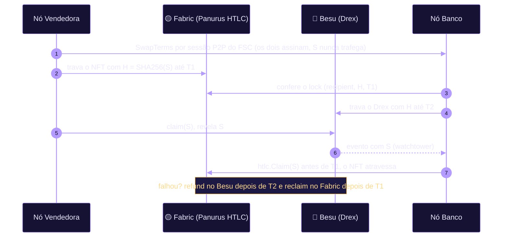
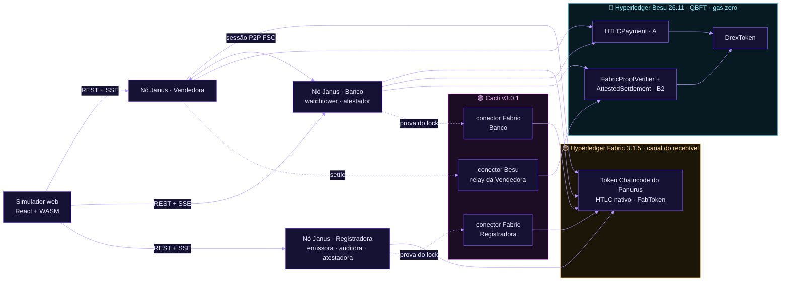
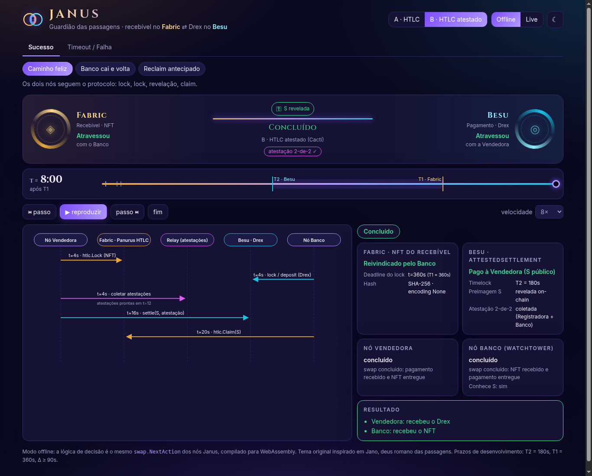
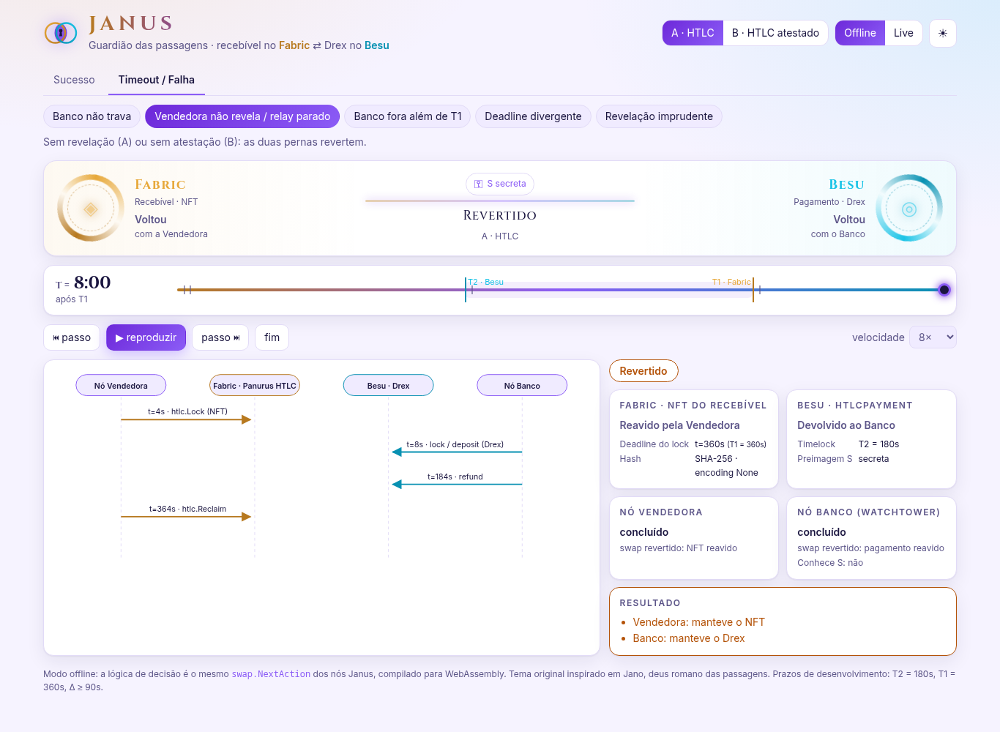

<p align="center">
  
</p>

<p align="center">
  
  
  
  
  <br>
  
  
  
  
</p>

<p align="center">
  <b>Liquidação atômica interbancária cross-chain (DvP)</b><br>
  o recebível tokenizado vive no <b>Hyperledger Fabric</b>, o Drex vive no <b>Hyperledger Besu</b>,<br>
  e <b>nenhum dos dois ativos sai da própria rede</b>.
</p>

---

## ⛩ As duas faces de Jano

Na mitologia romana, **Jano** é o deus das portas e das passagens. Ele tem duas faces, uma voltada para cada lado do umbral. O Janus é exatamente isso: um guardião entre dois mundos que nunca se misturam.

<table>
<tr>
<td width="50%" valign="top">

### 🟡 Portal do Fabric
**o recebível**

- NFT emitido pela **Registradora** (Panurus, FabToken)
- Travado no **HTLC nativo do Panurus**
- Política de endosso `AND(Registradora, Banco)`
- Auditoria com relógio próprio e gravames persistidos

</td>
<td width="50%" valign="top">

### 🔵 Portal do Besu
**o pagamento**

- **Drex** ERC-20 permissionado (2 casas, allowlist)
- `HTLCPayment` (A) ou `AttestedSettlement` (B2)
- QBFT com 4 validadores e gas zero
- P-256 nativo (EIP-7951) para verificar atestações

</td>
</tr>
</table>

A **chave** que abre os dois portais é a preimagem **S**: quem a revela recebe o Drex, e com ela o Banco reivindica o recebível. Os prazos `T1 > T2` garantem que, se algo der errado, **cada um volta com o que trouxe**.

## 🌀 Duas formas de atravessar

| | **A · HTLC** | **B2 · HTLC atestado** |
|---|---|---|
| Fabric | HTLC do Panurus (SHA-256, deadline `T1`) | o mesmo |
| Besu | `HTLCPayment`: claim com `S` antes de `T2` | `AttestedSettlement`: libera com `S` **e** uma atestação 2-de-2 do lock |
| Prova do lock | o Banco confere no próprio vault | **Hyperledger Cacti**: conector Fabric por org (bloco, validade, endossos), atestadores P-256, relay Besu do Cacti submete o `settle` |
| Ordem | NFT trava → Drex trava | o Drex pode travar primeiro (o contrato exige a prova) |
| ADRs | [0002](docs/adr/0002-spike-panurus-htlc.md), [0004](docs/adr/0004-tempo-no-fabric.md) | [0003](docs/adr/0003-spike-cacti-abordagem-b.md), [0005](docs/adr/0005-cacti-prova-de-ledger.md), [0006](docs/adr/0006-cacti-relay-besu.md) |



## 🏛 Arquitetura



Cada instituição roda **um binário** (`janus-node`): um nó do Fabric Smart Client com o Panurus, as views do Janus, o cliente Besu, o motor de liquidação, a API REST + SSE, um store SQLite e S cifrado (AES-GCM). Não existe custodiante central.

## 🔑 Atravessando: a demonstração completa

```sh
make deps          # Foundry, módulos Go e npm (simulador + Cacti)
make fabric-bins   # binários do Fabric 3.1.5 / CA 1.5.22 (uma vez)

make besu-up && make demo-besu    # Fabric + Panurus + Besu QBFT + Cacti + 3 nós Janus
# ou: make demo                    # o mesmo, com anvil no lugar do Besu QBFT

npm run web                        # outro terminal → http://localhost:5173
```

| Portal | Endereço |
|---|---|
| 🌐 Simulador web | http://localhost:5173 (`?mode=live` para os nós reais) |
| 🏛 Registradora · Vendedora · Banco | `:8080` · `:8081` · `:8082` (`/api/v1/...`) |
| 🟣 Cacti | `:4100` Registradora · `:4101` Banco (conector Fabric) · `:4102` relay (conector Besu) |
| 🔵 Besu QBFT | http://localhost:8545 |

**Pelo terminal:**

```sh
NFT=$(curl -s -X POST localhost:8080/api/v1/recebiveis -H 'content-type: application/json' \
  -d '{"owner":"vendedora","registro":"REG-001","cedente":"V","sacado":"S","valorFace":100000000,"vencimento":"2027-03-31"}' | jq -r .linearId)

SWAP=$(curl -s -X POST localhost:8081/api/v1/swaps -H 'content-type: application/json' \
  -d "{\"buyerNode\":\"banco\",\"assetId\":\"$NFT\",\"price\":90000000,\"protocol\":\"cacti\"}" | jq -r .swapId)

curl -s localhost:8082/api/v1/swaps/$SWAP | jq .status     # → "completed"
curl -sN localhost:8081/api/v1/events                        # passos do motor ao vivo
```

## 🖥 O simulador

<p align="center">
  
  
</p>

- **Offline:** os 9 cenários (sucesso e falha) rodam com o **mesmo `swap.NextAction` dos nós**, compilado para WebAssembly.
- **Live:** emite, propõe e acompanha swaps reais pelos nós, via SSE.
- Os dois portais mostram o estado de cada perna e da chave S. Há relógio com `T2`/`T1`, diagrama de sequência animado, inspetor por rede, tema escuro ("noite dos portais") e claro ("aurora"), e links compartilháveis: `?theme=dark&protocol=cacti&scenario=seller-no-reveal&t=end`.

## 🧪 Provas

| Nível | Comando | O que cobre |
|---|---|---|
| Vetores Go ↔ Solidity | `make test-vectors` | SHA-256 e digest/assinaturas P-256 idênticos nos dois lados |
| Contratos | `make test-contracts` | 51 testes, fuzz nas fronteiras de tempo e 4 invariantes |
| Nó | `make test-node` | núcleo, simulador, motor, API, cliente Besu (anvil), Cacti |
| Simulador | `make test-web` | reprodução e typecheck |
| Rede real | `make e2e` | Fabric 3.1.5 + Panurus (NWO) + Besu + Cacti + 3 nós Janus |

**Os 8 cenários do plano:**

| # | Cenário | A | B2 | Onde |
|---|---|:-:|:-:|---|
| 1 | Caminho feliz | ✅ | ✅ | A e B2 em rede real (também no Besu QBFT) |
| 2 | Banco não trava → o NFT volta depois de `T1` | ✅ | ✅ | A em rede real · B2 no simulador e no motor |
| 3 | Vendedora não revela / relay parado → as duas pernas revertem | ✅ | ✅ | A em rede real · B2 no simulador; relay e Cacti fora do ar verificados no demo |
| 4 | Revelação em `T2 − ε` → o Banco ainda faz o claim | ✅ | — | A em rede real |
| 5 | O nó cai e volta → reconciliação | ✅ | ✅ | A em rede real (Banco) · B2 em rede real (Registradora reiniciada) |
| 6 | Deadline divergente → o Banco recusa o lock | ✅ | ✅ | A em rede real · B2 no simulador |
| 7 | Prova adulterada ou endossante insuficiente → rejeitada | — | ✅ | contratos + EVM real · conector Cacti |
| 8 | Reclaim antecipado → recusado pela auditoria | ✅ | ✅ | rede real (mesmo HTLC do Panurus nas duas) |

## 📜 Pergaminhos

| Documento | |
|---|---|
| [Plano de implementação](docs/implementation_plan.md) | escopo, arquitetura e fases |
| [ADR-0001](docs/adr/0001-versoes-fixadas.md) · [0002](docs/adr/0002-spike-panurus-htlc.md) · [0003](docs/adr/0003-spike-cacti-abordagem-b.md) · [0004](docs/adr/0004-tempo-no-fabric.md) · [0005](docs/adr/0005-cacti-prova-de-ledger.md) · [0006](docs/adr/0006-cacti-relay-besu.md) | versões, Panurus, Cacti, tempo, prova de ledger, relay |
| [Modelo de ameaças](docs/threat-model.md) | 17 ameaças, mitigações, evidências e riscos residuais |
| [Runbook](docs/runbook.md) | `janus.json`, operação e incidentes |
| [infra/fabric](infra/fabric/README.md) | como a rede Fabric é gerada (NWO) |

<details>
<summary><b>🗺 Mapa do repositório</b></summary>

| Caminho | Conteúdo |
|---|---|
| `contracts/` | Foundry: `DrexToken`, `HTLCPayment`, `FabricProofVerifier`, `AttestedSettlement` |
| `node/internal/swap` · `swap/sim` | núcleo puro (termos, tempo, `NextAction`) e simulador determinístico |
| `node/internal/token` | views do Panurus: emissão, lock/claim/reclaim, status, auditoria, negociação, atestação |
| `node/internal/besu` · `cacti` | cliente Besu (abigen v2, watcher) e clientes dos conectores do Cacti |
| `node/internal/engine` · `protocol/{htlc,cacti}` | motor (watchtower/watchdog, falhas injetáveis) e as duas abordagens |
| `node/internal/janus` · `cmd/janus-node` | SDK do FSC que monta o nó e o binário único por instituição |
| `node/internal/{api,store,secrets}` | REST + SSE, SQLite (swaps e estado durável), S cifrado |
| `node/topology` | topologia NWO, testes de integração e E2E, runner `janus-net` |
| `node/ci/external-builders/golang` | external builder do chaincode (Go 1.27 no host) |
| `infra/besu` · `infra/cacti/relay` | QBFT local e servidores Cacti |
| `apps/web` · `node/cmd/simwasm` | simulador web e núcleo em WASM |
| `testdata/vectors` | vetores compartilhados Go ↔ Solidity |

</details>

---

<sub>
⚠️ As chaves em <code>infra/besu/config/permissions_config.toml</code>, <code>contracts/script/Deploy.s.sol</code> e nos testes são as contas <b>públicas de desenvolvimento</b> do Foundry/anvil. Nunca use essas chaves fora do ambiente local. Keychains em memória e servidores Cacti sem autorização servem apenas para desenvolvimento (ver o runbook).<br><br>
O tema visual é original, inspirado na figura mitológica de Jano, deus romano das passagens. Não usa arte, marcas nem personagens de terceiros, e não tem afiliação com jogos ou franquias que retratem Jano.
</sub>
