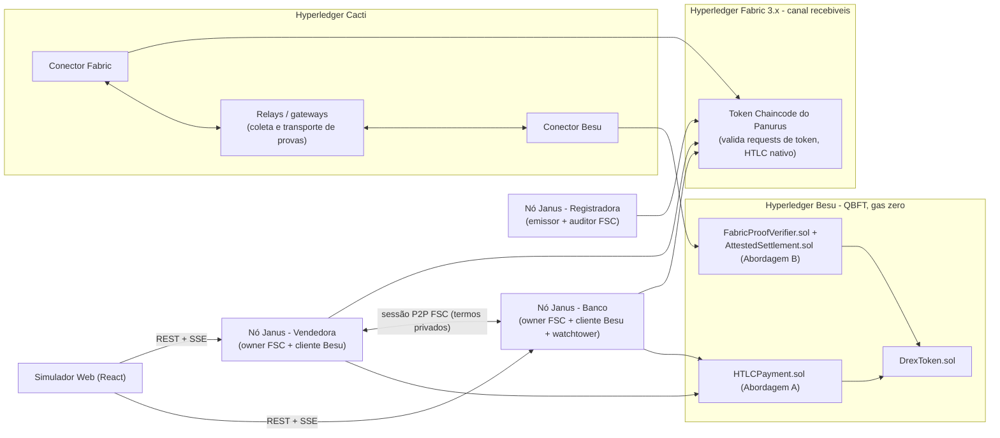
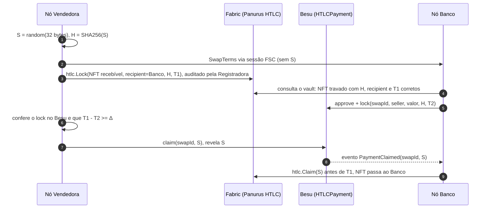
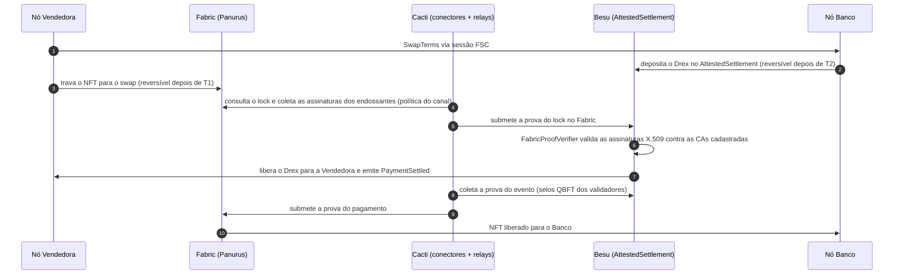

# Janus — Plano de Implementação (v2)
### Liquidação Atômica Interbancária Cross-Chain (DvP) · Hyperledger Fabric + Panurus ↔ Hyperledger Besu (Drex) · HTLC **e** Hyperledger Cacti

## Decisões incorporadas nesta versão

| # | Decisão | Como entra no plano |
|---|---|---|
| 1 | **Go** | Lado Fabric (Panurus/FSC) e agentes em Go. Um único binário por instituição |
| 2 | **Cacti já no MVP** | As duas abordagens no MVP: **A (HTLC)** e **B (atestação via Cacti)**, ambas atrás da interface `SettlementProtocol` |
| 3 | **Foundry** | Contratos Solidity, testes de fuzz/invariantes e deploy |
| 4 | **O mais limpo e seguro** | Sem fork do peer nem plugin de endosso. Defesa em camadas no tempo do Fabric (seção 6) |
| 5 | **Sempre o mais atualizado** | Fabric **3.x** (última estável compatível com o Panurus), Besu, Solidity 0.8.x, Foundry, Cacti e Panurus nas últimas releases. Versões fixadas num ADR na Fase 0 |
| 6 | **Ordem a meu critério** | Spikes → contratos Besu → rede Fabric/Panurus → HTLC ponta a ponta → Cacti → UI → E2E (seção 4) |
| — | **Panurus no lado Fabric** | Substitui o chaincode customizado. Detalhes logo abaixo |

> [!IMPORTANT]
> **Correção de entendimento sobre o Panurus.** O [Panurus](https://github.com/LFDT-Panurus/panurus) (antigo *Fabric Token SDK*, hoje projeto da LF Decentralized Trust) **não é uma ferramenta para montar a rede Fabric**. Ele é uma **camada de tokens** que roda *sobre* uma rede Fabric: APIs para emitir, transferir, trocar e auditar tokens, com transações orquestradas pelo **Fabric Smart Client (FSC)**. Recursos nativos que encaixam no Janus: **swaps atômicos/interoperabilidade (HTLC)**, **auditoria**, **drivers de privacidade** (FabToken em texto claro, ZKAT-DLog com provas de conhecimento zero) e **identidades X.509/Idemix**.
> A rede Fabric em si continua sendo montada com as ferramentas do Fabric. Vamos seguir o caminho que o próprio Panurus recomenda (a amostra `fabric-samples/token-sdk`) e usar o **NWO** (Network Orchestrator do FSC) para criar redes programaticamente nos testes de integração.
> **Ganho para o projeto:** o HTLC do lado Fabric deixa de ser código nosso e passa a usar a implementação mantida pelo Panurus. Nosso código fica nas *views* (fluxos de negócio) e na integração com o Besu.

---

## 1. Objetivo e escopo

- O **recebível tokenizado (RWA)** é um **token não fungível do Panurus** emitido pela **Registradora** no Fabric e **nunca sai do Fabric**.
- O **Drex** é um ERC-20 permissionado no **Besu (QBFT)** e **nunca sai do Besu**.
- A troca é **atômica** por dois mecanismos, que a mesma UI e a mesma API conseguem selecionar:
  - **A — HTLC:** SHA-256 e timelocks escalonados (`T_ativo > T_moeda`), sem oráculo.
  - **B — Cacti:** provas criptográficas de consenso (endosso do Fabric ↔ selo QBFT do Besu) transportadas por componentes do Hyperledger Cacti.
- Cada instituição roda **o seu próprio nó Janus** (nó FSC + cliente Besu + API) com as suas próprias chaves. Não existe custodiante central.
- O **simulador web** reproduz a referência abaixo e ganha um seletor de abordagem (A/B) e um modo *live*.


| No escopo do MVP | Fora do escopo |
|---|---|
| Abordagens A e B completas, de ponta a ponta | Deploy em nuvem/Kubernetes, HSM/KMS real |
| Fabric: Registradora (emissora + auditora), Vendedora e Banco | Fracionamento do recebível e liquidação em lote |
| Besu QBFT local com 4 validadores e gas zero | Integração com o Drex real do BCB |
| Driver FabToken (texto claro) | ZKAT-DLog (privacidade ZK) como fase opcional |

---

## 2. Arquitetura



### Stack

| Componente | Tecnologia |
|---|---|
| Rede Fabric | Fabric **3.x** com Fabric CA e orderer Raft (com BFT disponível), montada a partir do padrão `fabric-samples/token-sdk`. **NWO** para os testes de integração em Go |
| Camada de tokens | **Panurus** (última release) + **Fabric Smart Client**. Token Chaincode do Panurus. Driver FabToken |
| Nó Janus (por instituição) | **Go**: nó FSC com as *views* do Panurus, cliente Besu via `go-ethereum` com bindings `abigen` gerados dos artefatos do Foundry, API REST + SSE e persistência (vault do FSC + SQLite) |
| Rede Besu | Besu (última), 4 validadores QBFT, `min-gas-price=0`, allowlist de contas |
| Contratos | **Solidity 0.8.x** + **Foundry** + OpenZeppelin |
| Interoperabilidade (B) | **Hyperledger Cacti** (última release): conectores Fabric/Besu e componentes de prova (Weaver/relays). O SATP-Hermes fica avaliado como alternativa (ver os riscos) |
| Simulador | **React + Vite + TypeScript** |

### Estrutura de diretórios

```
Janus/
├── Makefile                      # up, down, deploy, test, demo, e2e
├── docs/adr/                     # versões fixadas, decisões (Panurus, Cacti, tempo)
├── infra/
│   ├── fabric/                   # rede Fabric 3.x + CA + deploy do Token Chaincode do Panurus
│   ├── besu/                     # genesis QBFT, compose, chaves
│   └── cacti/                    # conectores, relays/gateways, configs
├── node/                         # módulo Go: o nó Janus
│   ├── cmd/janus-node/           # binário único; o papel vem da config (registradora|vendedora|banco)
│   ├── internal/token/           # views Panurus: issue, lock, claim, reclaim, consultas, auditoria
│   ├── internal/besu/            # bindings abigen, listener de eventos, cliente de transações
│   ├── internal/swap/            # SwapTerms, máquina de estados, política de tempo, interface SettlementProtocol
│   ├── internal/protocol/htlc/   # Abordagem A
│   ├── internal/protocol/cacti/  # Abordagem B
│   ├── internal/api/             # REST + SSE para a UI
│   └── topology/                 # topologias NWO dos testes de integração
├── contracts/                    # Foundry: DrexToken, HTLCPayment, FabricProofVerifier, AttestedSettlement
├── apps/web/                     # simulador
└── e2e/                          # cenários adversariais (Go + redes reais)
```

---

## 3. Protocolo

### 3.1 Termos canônicos (`SwapTerms`)

Os termos são trocados entre os nós da Vendedora e do Banco por **sessão P2P do FSC** (canal autenticado com X.509). Isso **substitui a PDC** do plano anterior: o valor do acordo não vai para o ledger do Fabric. Os dois lados assinam o hash canônico dos termos antes de qualquer lock.

```go
type SwapTerms struct {
    SwapID    [32]byte        // sha256(hashlock || seller || buyer || nonce)
    Protocol  string          // "htlc" | "cacti"
    AssetID   string          // ID do token NFT (recebível) no Panurus
    Seller    Party           // identidade FSC/X.509 + endereço EVM
    Buyer     Party
    Price     Amount          // token Drex + valor em unidades mínimas
    Hashlock  [32]byte        // só na Abordagem A: H = SHA256(S), com S de 32 bytes
    T1, T2    int64           // timelocks absolutos (unix s); na B, T1 é o prazo de reversão
    Networks  NetworkRefs     // canal/namespace do Fabric, chainId e contratos do Besu
}
```

### 3.2 Abordagem A — HTLC (Panurus no Fabric + Solidity no Besu)



Na falha, as reversões são o `refund` no Besu depois de `T2` e o **`htlc.Reclaim`** do Panurus no Fabric depois de `T1`.

### 3.3 Abordagem B — Atestação via Cacti



- Ninguém precisa gerar segredo: a atomicidade vem das **provas de consenso** das duas redes. Os prazos `T2 < T1` continuam existindo como **rede de segurança** para reversão se o relay parar.
- O verificador Solidity guarda as chaves públicas das CAs das orgs do Fabric e a política de endosso exigida (ex.: 2 de 2 orgs).

> [!WARNING]
> **A Abordagem B tem um ponto que pode exigir estender o Panurus.** O Panurus libera um token travado com preimagem (claim) ou por prazo (reclaim). **Liberar o token mediante uma prova vinda do Besu** não é uma condição nativa conhecida. O spike da Fase 0 decide entre:
> - **(B1)** um *validador/ação customizada* do Panurus que aceite a prova Cacti verificada pela camada de interoperabilidade do Fabric (o mais fiel ao texto, porém o mais invasivo);
> - **(B2) "HTLC atestado"** (minha recomendação se a B1 se mostrar invasiva demais): manter o lock por hashlock do Panurus no Fabric e trocar no Besu a verificação "confia no que o Banco leu" por **prova Cacti do lock**. O Besu só aceita o claim da Vendedora se a prova do lock no Fabric for válida, e a revelação de `S` continua liberando o NFT. Sem fork do Panurus.

### 3.4 Regras de tempo (as duas abordagens)

$$
T_1 - T_2 \;\ge\; \Delta = t_{\text{detecção}} + t_{\text{finalidade Fabric}} + t_{\text{relay}} + \varepsilon_{\text{skew}} + m_{\text{operacional}}
$$

- Fronteira idêntica nas duas redes: claim se `agora < T`, reversão se `agora >= T`.
- Produção: `T1 = 4h`, `T2 = 2h`. Dev/E2E: minutos, configurável.
- **Hashing interoperável (A):** `S` tem exatamente 32 bytes. SHA-256 em Go (`crypto/sha256`) e no Solidity (`sha256(abi.encodePacked(bytes32))`), com **vetores de teste compartilhados** entre `go test` e `forge test`. O spike confirma qual função de hash o HTLC do Panurus usa e como ela é configurada.

---

## 4. Fases (na ordem que escolhi)

**Por que essa ordem:** os maiores riscos técnicos são o Panurus, o Cacti e o tempo no Fabric. Por isso eles são investigados primeiro, em spikes curtos. Os contratos do Besu não dependem de nada e são testáveis isoladamente, então vêm logo depois. A UI vem quando já houver fluxo real para mostrar. O modo offline dela pode avançar em paralelo.

### Fase 0 — Fundação e spikes (decisões com evidência)
- **Spike Panurus:** subir a amostra `fabric-samples/token-sdk` em Fabric 3.x. Emitir um NFT, fazer `htlc.Lock` / `Claim` / `Reclaim` e confirmar a função de hash, a **fonte de tempo do validador HTLC** e o papel do auditor.
- **Spike Cacti:** confirmar na última release quais componentes cobrem **prova de estado Fabric → Besu** e **prova de evento Besu → Fabric** (Weaver/relays, conectores, SATP-Hermes) e fechar a decisão B1/B2.
- **Spike de tempo:** reproduzir o ataque de timestamp forjado (seção 6) e validar a mitigação escolhida.
- Monorepo, `Makefile`, ADR de versões e `infra/besu` (QBFT).
- **Pronto quando:** existe o ADR com versões fixadas e as decisões B1/B2 e de tempo documentadas com evidência.

### Fase 1 — Contratos Besu (Foundry)
- `DrexToken.sol`: ERC-20 com 2 casas decimais, papéis `ISSUER_ROLE` e allowlist (`AccessControl`).
- `HTLCPayment.sol` (A): `lock`, `claim(swapId, preimage)` e `refund`. **Claim e refund são permissionless** (os fundos sempre vão para o destino correto). Usa `SafeERC20`, `ReentrancyGuard` e bloqueio de reuso de hashlock.
- `FabricProofVerifier.sol` + `AttestedSettlement.sol` (B): registro de CAs e política de endosso, verificação ECDSA P-256 das assinaturas dos endossantes e liquidação condicionada à prova.
- Testes unitários, **fuzz** (`vm.warp` nas fronteiras de tempo) e **invariantes** (saldo do contrato = soma dos locks ativos; nenhum swap fica claimed e refunded ao mesmo tempo).

### Fase 2 — Rede Fabric + Panurus
- `infra/fabric`: Fabric 3.x, Fabric CA, orgs **Registradora**, **Vendedora** e **Banco**, canal `recebiveis` e deploy do Token Chaincode do Panurus com os parâmetros públicos do driver FabToken.
- `node/internal/token`: views de **emissão do recebível** (só a Registradora), consulta, **lock/claim/reclaim HTLC** e **auditoria**: a Registradora audita toda transação e recusa um recebível com gravame ou que já esteja travado.
- `node/topology`: a mesma rede descrita em NWO para testes de integração automatizados.

### Fase 3 — Abordagem A ponta a ponta (nós Janus)
- `internal/swap`: `SwapTerms`, assinatura dos termos, **máquina de estados pura** derivada do estado das duas cadeias e a função `NextAction(papel, estado, termos, agora)` com toda a lógica de decisão, testável sem rede.
- `internal/besu`: listener com checkpoint e backfill, e envio de transações.
- Papéis: a **Vendedora** gera e guarda `S` cifrado, trava o NFT, valida o lock no Besu e revela `S`. O **Banco** valida, trava o Drex e atua como **watchtower** de `PaymentClaimed`, fazendo o claim no Fabric com retry. O **watchdog** cuida das reversões. A **reconciliação no boot** usa a cadeia como fonte da verdade.
- API REST + SSE, com flags de falha injetada (`--no-lock`, `--no-reveal`, `--crash-after-reveal`).

### Fase 4 — Abordagem B (Cacti)
- `infra/cacti`: conectores Fabric e Besu e relays/gateways em Docker.
- `internal/protocol/cacti`: a implementação de `SettlementProtocol` conforme a decisão B1/B2, com a coleta e submissão de provas e o acompanhamento de estado.
- Cadastro das CAs do Fabric no `FabricProofVerifier` e dos validadores QBFT no lado Fabric.

### Fase 5 — Simulador Web
- Abas **Sucesso** e **Timeout/Falha** (com subcenários), **seletor A (HTLC) / B (Cacti)**, relógio, diagrama de sequência animado, inspetor de estado por rede (NFT do Panurus, lock HTLC, contrato Besu, provas Cacti) e navegação passo a passo.
- **Modo offline** (máquina de estados embutida) e **modo live** (SSE dos nós Janus, com hashes de transação reais).

### Fase 6 — E2E, hardening e documentação

| # | Cenário | A | B |
|---|---|---|---|
| 1 | Caminho feliz | ✔ | ✔ |
| 2 | Comprador não trava → reversão do NFT depois de `T1` | ✔ | ✔ |
| 3 | Vendedor não revela / relay parado → as duas pernas revertem | ✔ | ✔ |
| 4 | Revelação em `T2 − ε` → Banco ainda faz o claim antes de `T1` | ✔ | — |
| 5 | Nó do Banco cai depois da revelação e volta → reconciliação | ✔ | ✔ |
| 6 | Preimagem errada / hashlock reutilizado / NFT já travado | ✔ | — |
| 7 | Prova Cacti adulterada ou com endossante insuficiente → rejeitada | — | ✔ |
| 8 | Timestamp forjado no Fabric → rejeitado | ✔ | ✔ |

Entregáveis de documentação: modelo de ameaças, ADRs e runbook.

---

## 5. Verificação

| Nível | Comando |
|---|---|
| Vetores de hash | `make test-vectors` (Go ↔ Solidity) |
| Lógica do nó | `cd node && go test ./... -cover` (máquina de estados, `NextAction`, validação de termos) |
| Contratos | `cd contracts && forge test -vvv` (+ fuzz/invariantes) |
| Integração Fabric/Panurus | `go test ./topology/...` (redes NWO) |
| E2E | `make up deploy && make e2e` (os 8 cenários, nas abordagens A e B) |
| UI | `npm run dev -w apps/web` + navegador, nos modos offline e live |

---

## 6. Riscos e decisões de segurança

> [!WARNING]
> **Tempo no Fabric (decisão 4: o mais limpo e seguro).** O timestamp da transação no Fabric é definido pelo cliente e não é validado pelos peers. Um vendedor malicioso poderia antecipar o *reclaim* do recebível depois de já ter recebido o Drex.
> **Abordagem escolhida (sem fork do peer, sem plugin de endosso, sem código não determinístico no validador):**
> 1. **Política de endosso** do Token Chaincode exigindo os peers das orgs envolvidas, para que a contraparte sempre participe;
> 2. **Auditor (Registradora) como ponto único de checagem**: a view de auditoria recusa assinar transações HTLC cujo tempo declarado divirja do relógio do auditor além de uma tolerância (ex.: 30s). Isso reaproveita um papel que o Panurus já tem, sem mexer no consenso;
> 3. **Margem Δ** entre `T1` e `T2` dimensionada com a tolerância de skew.
>
> O spike de tempo confirma onde o validador HTLC do Panurus lê o tempo. Se a camada 2 não for viável, a alternativa documentada é contribuir uma checagem equivalente no próprio Panurus (upstream), não fazer um fork local.

> [!CAUTION]
> **Disponibilidade do Banco (A) e dos relays (B) é requisito de segurança.** Na A, se o watchtower do Banco ficar fora do ar por mais de `T1 − T2` depois da revelação, o Banco perde o ativo. Mitigação: claim permissionless, watchtowers redundantes e alertas. Na B, relays redundantes e os timelocks como rede de segurança.

Outros riscos:
- **Maturidade e compatibilidade:** o Panurus avisa que não foi auditado e muda rápido. As versões do Panurus, do FSC e do Fabric 3.x precisam ser compatíveis entre si, e o ADR da Fase 0 fixa a combinação testada.
- **Cacti:** o SATP-Hermes modela *transferência* de ativos entre redes (trava na origem, representação no destino), o que contraria a premissa jurídica de que o ativo **nunca sai do Fabric**. Por isso a Abordagem B usa o Cacti para **provas/atestações**, não para mover o ativo.
- **ECDSA P-256 no Besu:** o custo de gas é irrelevante numa rede com gas zero, mas o limite de gas por bloco ainda conta. O spike confirma se a versão atual do Besu tem precompile P-256 (RIP-7212) ou se a verificação será feita em Solidity puro.
- **Privacidade:** o valor do lock fica visível no Besu. O ZKAT-DLog do Panurus resolve a privacidade só do lado Fabric.

---

## 7. O que mudou em relação à v1

- O chaincode customizado `htlc-asset` foi **removido**. Entram o **Token Chaincode do Panurus** e o **HTLC nativo** dele.
- A **PDC foi removida**. Os termos privados agora são trocados por **sessão P2P do FSC**.
- Os agentes passam de TypeScript para **Go**, num **binário único por instituição** (nó FSC + cliente Besu).
- A **Abordagem B (Cacti)** saiu de "futura" e entrou no MVP, com contratos de verificação de prova.
- A versão-alvo passou de Fabric 2.5 LTS para **Fabric 3.x**, todas as dependências nas últimas versões, e entrou a **Fase 0 de spikes**.
- A mitigação de tempo saiu do chaincode e passou para a **auditoria do Panurus**, junto com a política de endosso.
